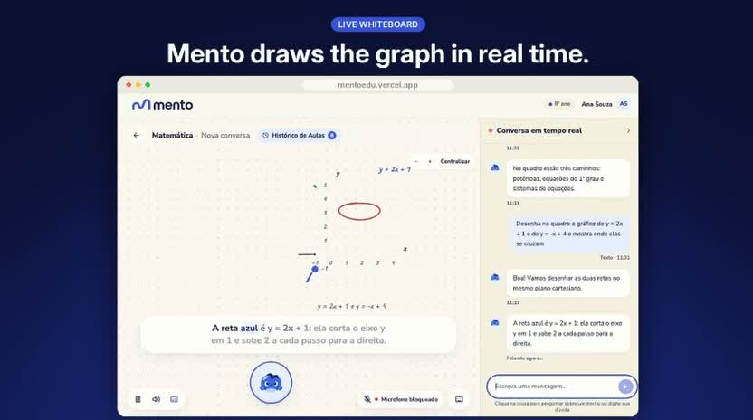

<p align="center"></p>

<p align="center"><b>An AI tutor for schools that writes and draws live on a whiteboard, answers from the teacher's own materials, and turns every tutoring session into insights for the teacher.</b></p>

<p align="center">
  <a href="assets/demo/mento-demo.mp4"></a>
  <br>
  <a href="assets/demo/mento-demo.mp4">▶ Watch the demo (1 min)</a>
</p>

> **Status:** hackathon prototype built in ~24h (Teachy-backed hackathon). Not a product in production: no paying customers, no efficacy study. Data shown in the teacher views is seeded and carries a "simulated data" badge.

## Why

*The school defines what must be learned; Mento teaches each student individually and turns the evidence from those tutoring sessions into pedagogical intelligence for the teacher.*

## What it does

**For the student**
- Talks to the tutor by **text or voice** (pt-BR speech in and out).
- Watches the tutor **write and draw on a whiteboard in real time**: text, diagrams, graphs, images, step by step.
- Clicks an object on the board and asks about it.
- Sees **which page of the teacher's material** each explanation came from; answers outside the material are flagged.

**For the teacher** (single workspace, no login)
- Uploads **materials** (PDFs such as textbooks) that ground the tutor's answers.
- Describes the **class** (grade level and characteristics; MVP focus: 7º–9º ano).
- Manages **students** and sees, per student, how they are evolving: **gaps, progress and suggested next steps**, produced by an automatic analysis of each conversation. The AI suggests; the teacher decides.

Subjects with a tutor profile: History, Math, Biology, Physics, plus a generic fallback ([`prompts/subjects/`](prompts/subjects/)). The product is in **Brazilian Portuguese**.

## How it works

```
 Student (Next.js)                         API (Fastify)                          Providers
 ┌──────────────────┐   turn (SSE)    ┌──────────────────────────┐
 │ Whiteboard + chat│ ◄─────────────► │ tutor: prompt + tools    │ ──► Claude (tutor, judge)
 │ Voice orb        │                 │ sources: PDF retrieval   │ ──► Voyage (embeddings)
 └──────────────────┘                 │ board: draw commands     │ ──► Gemini (images)
 ┌──────────────────┐   REST + SSE    │ voice: STT tokens, TTS   │ ──► Deepgram / ElevenLabs
 │ Teacher panel    │ ◄─────────────► │ analysis: insights       │
 └──────────────────┘                 └────────────┬─────────────┘
                                                   ▼
                                              MongoDB
```

1. The student sends a message; the API retrieves relevant passages from the teacher's PDFs.
2. The tutor (Claude) answers through **tool calls** that the API streams to the browser over SSE as board commands (write, draw, highlight) plus the spoken reply.
3. Each conversation is stored; when it ends, an analysis step extracts evidence and writes **insights** for the teacher.

Details: [`docs/07-architecture-and-data.md`](docs/07-architecture-and-data.md) · [`docs/16-technical-roadmap.md`](docs/16-technical-roadmap.md).

## Tech stack

TypeScript monorepo (pnpm workspaces) · **Next.js 16 / React 19** (front end only) · **Fastify 5** (API, SSE) · **Zod** contracts shared by both sides · **MongoDB** (Mongoose) · Vitest · GitHub Actions CI.

## Repository layout

```
apps/web/        Next.js front end: student whiteboard (/) and teacher panel (/professor)
apps/api/        Fastify API: routes, SSE streams, jobs (the only composition root)
packages/
  contracts/     Zod schemas shared by web and API
  ui/            shared design system
  board/         whiteboard renderer, action queue, SSE client
  tutor/         tutor loop, prompts and tools
  sources/       PDF ingestion, retrieval, citations
  analysis/      conversation analysis → insights
  db/            Mongoose models
  voice/         speech-to-text / text-to-speech
prompts/         tutor prompts as editable text (base, subjects, analysis)
scripts/         tsx dev/ops scripts (seed, ingest, smoke tests)
fixtures/        JSON fixtures validated against the contracts
docs/            product and technical documentation (numbered)
workstreams/     how the work was split between the 3 people
```

More: [`docs/21-repo-structure.md`](docs/21-repo-structure.md).

## Getting started

**Requirements:** Node ≥ 22, pnpm, and a MongoDB (local or Atlas).

```bash
pnpm install
```

```bash
cp .env.example .env
```

Fill in `.env`. With `DEMO_MODE=fixture` the app replays recorded turns and needs no provider keys; with `DEMO_MODE=live` set `ANTHROPIC_API_KEY` and, for the full experience, `VOYAGE_API_KEY`, `DEEPGRAM_API_KEY`, `ELEVENLABS_API_KEY`/`ELEVENLABS_VOICE_ID` and `GEMINI_API_KEY`. Every variable is documented in [`.env.example`](.env.example).

```bash
pnpm seed
```

```bash
pnpm dev
```

- Student: http://localhost:3000
- Teacher: http://localhost:3000/professor
- API: http://localhost:4000

To ground the tutor in a book, upload a PDF in the teacher's **Materiais** tab (or run `pnpm ingest`; see [`scripts/README.md`](scripts/README.md)).

## Useful commands

| Command | What it does |
|---|---|
| `pnpm dev` | Runs web (:3000) and API (:4000) together |
| `pnpm typecheck` · `pnpm lint` · `pnpm test` | Type-check, lint and test every package |
| `pnpm test:rules` | Runs the tests and prints the business-rule report |
| `pnpm seed` · `pnpm seed:lab` | Load demo students, class context and lab conversations |
| `pnpm ingest` · `pnpm retrieval:check` | Ingest PDFs and check retrieval quality |
| `pnpm llm:smoke` · `pnpm voice:smoke` | Quick checks that the providers respond |

Full list: [`scripts/README.md`](scripts/README.md).

## Principles

- **Cites its sources.** Answers from the teacher's material show the page; anything outside it is flagged.
- **The teacher decides.** The AI suggests; it never automates high-impact pedagogical decisions.
- **Educational evidence only.** No "learning styles", no psychological or sensitive inferences; students may be minors (LGPD). See [`docs/08-privacy-zdr-security.md`](docs/08-privacy-zdr-security.md).
- **Simulated data is always labelled** as such.

## Documentation

- **AI agents:** start at [`AGENTS.md`](AGENTS.md) — just say *"Study the repository"*.
- **People:** [`docs/00-product-vision.md`](docs/00-product-vision.md), then [`docs/01-hackathon-scope.md`](docs/01-hackathon-scope.md). Full index: [`docs/README.md`](docs/README.md).
- Decisions: [`docs/10-decisions.md`](docs/10-decisions.md) · Demo runbook: [`docs/20-demo-runbook.md`](docs/20-demo-runbook.md) · Brand: [`docs/19-brand-assets.md`](docs/19-brand-assets.md) · CI and deploy: [`docs/ci-cd.md`](docs/ci-cd.md) · Division of work: [`workstreams/`](workstreams/README.md) · Founder's requirements: [`prompts/founder-conversation/`](prompts/founder-conversation/README.md).

## Team and language

Built by a team of 3 during a 2-day hackathon backed by Teachy. Repository, code and docs are in **English**; the product (UI, tutor, demo content) is in **Brazilian Portuguese**.
